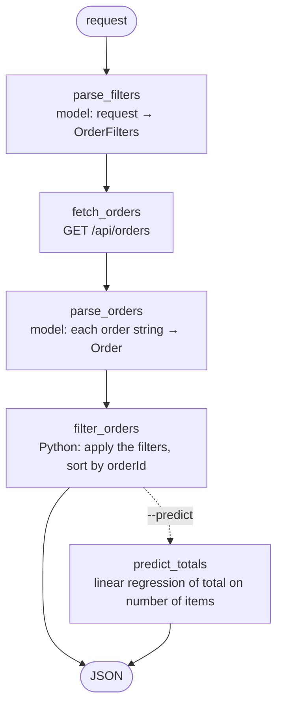

# Natural-language order queries with LangGraph

[](https://github.com/michaelperez023/raft-challenge-michaelperez/actions/workflows/ci.yml)

Ask for customer orders in plain English, such as "Show me all orders where the buyer was located in Ohio and total value was over 500", and get the matching orders back as JSON. A LangGraph graph has a model (OpenAI's gpt-oss-120b, through OpenRouter) turn the request into search filters, and turn each order from an API that returns messy text into a structured record. Every reply is validated with Pydantic, each parsed order is checked against the text it came from, and the filtering itself is plain Python.

This is my solution to the take-home challenge from Raft's AI Engineer hiring process, completed in May 2026. Raft provided the brief, [Instructions.md](Instructions.md), and the dummy orders API, [dummy_customer_api.py](dummy_customer_api.py); both are unchanged here. The version I submitted is tagged [`submission-2026-05-17`](https://github.com/michaelperez023/raft-challenge-michaelperez/tree/submission-2026-05-17). This version fixes the bugs listed under [Changes since the submission](#changes-since-the-submission) and adds an offline mode, tests and CI.

## Example

This run uses `--offline`, which replaces the model with [fake_llm.py](fake_llm.py), a deterministic rule-based stand-in (see [Offline mode](#offline-mode)). The output comes from that fake, not from a model:

```console
$ python main.py --offline "Show me all orders where the buyer was located in Ohio and total value was over 500."
Offline mode: replies come from fake_llm.py, a rule-based stand-in for the model. Nothing is sent to OpenRouter.
INFO: Parsing the request into filters
INFO: Filters: {"state":"OH","min_total":500.0}
INFO: Fetching orders
INFO: Fetched 5 orders
INFO: Parsing 5 orders, one model call each
INFO: Parsed 5 of 5 orders
INFO: 3 of 5 orders match
{
  "orders": [
    {
      "orderId": "1001",
      "buyer": "John Davis",
      "state": "OH",
      "total": 742.1
    },
    {
      "orderId": "1003",
      "buyer": "Mike Turner",
      "state": "OH",
      "total": 1299.99
    },
    {
      "orderId": "1005",
      "buyer": "Chris Myers",
      "state": "OH",
      "total": 512.0
    }
  ]
}
```

The log goes to standard error. The JSON goes to standard output, in the format that the brief specifies.

## How it works



[agent.py](agent.py) builds this graph; a test checks that the diagram matches it.

| Node | What it does |
|---|---|
| `parse_filters` | One model call turns the request into `OrderFilters`: `orderId`, `buyer`, `state`, `min_total` and `max_total`, each `null` when the request does not ask for it, and whether each bound is inclusive ("at least 512") or strict ("over 500"). |
| `fetch_orders` | Calls `GET /api/orders`. The response must be a JSON object with a `raw_orders` list; anything else stops the run with an error that says what arrived. |
| `parse_orders` | One model call per order turns its text into an `Order`: `orderId`, `buyer`, `state`, `total` and `items`. An order that cannot be parsed is skipped and reported, and the others are kept. |
| `filter_orders` | Applies the filters in plain Python and sorts the matches by `orderId`. |
| `predict_totals` | Only with `--predict`: see [Predicting totals](#predicting-totals). |

### Constraining the model

Every model reply goes through the same steps (`call_llm` in [agent.py](agent.py)):

1. The prompt lists the exact keys and their types, and the request asks for structured output with a strict JSON schema built from the Pydantic model. Providers that do not support structured output ignore it; the next steps apply either way.
2. The first JSON object in the reply is taken, so text or code fences around it do not matter.
3. Pydantic validates it and rejects unknown keys. Harmless formatting is normalized in code first: `1001`, `"#1001"`, `"Order 1001"`, `"ORDER-1001"` and `"Order No. 1001"` become `"1001"`, `"oh"` and `"Ohio"` become `"OH"`, and `"$1,299.99"` becomes `1299.99`.
4. For an order, every value must appear in the order's text, ignoring case: the order number, each word of the buyer's name, the state's code or full name, the total and each item. A reply with a value that is not in the text is rejected.
5. A rejected reply goes back to the model with the error, once. If the second reply fails too, the order is skipped, or, for the filters, the run stops.

Calls use temperature 0 and a fixed seed. The results are sorted, so the output does not depend on the order in which the dummy API returns the orders (it shuffles them). A hosted model is still not fully deterministic: OpenRouter routes requests to different providers, which run the model at different precisions.

### The brief's edge cases

- **Context window overflow.** Each order is parsed in its own call, so a prompt holds one order however many the API returns. Orders over 2,000 characters are skipped, and requests over 1,000 characters are refused.
- **Model hallucination.** Structured output, validation, and the check that each value appears in the order's text (steps 1, 3 and 4 above). The check catches values that are not in the text, not every misreading: any number in the text, such as the order number, passes as the total, and a state code that is also a word, such as IN or OR, passes when that word is in the text.
- **Unpredictable API schema changes.** The model reads free text, so new wording or a new field order in the strings needs no code change, and records that arrive as JSON objects instead of strings are passed to the model as JSON text. A missing or renamed `raw_orders` list, a `status` other than `ok`, a body that is not JSON and HTTP errors stop the run with an error message.
- **Failed model calls.** The OpenAI SDK retries connection errors, rate limits (429) and server errors (5xx) up to three times with exponential backoff. If an order's call still fails, that order is skipped. An invalid key, an unknown model and other request errors would fail for every order, so they stop the run.

Skipped orders are logged with the reason, and `main.py` then exits with status 3, so a script can tell that the results may be incomplete.

## Running it

Requires Python 3.12, 3.13 or 3.14. On 3.15, pip has to compile two of the dependencies, PyYAML and zstandard, which had no 3.15 wheels in November 2026.

```bash
git clone https://github.com/michaelperez023/raft-challenge-michaelperez.git
cd raft-challenge-michaelperez
python3 -m venv .venv
source .venv/bin/activate        # on Windows: .venv\Scripts\activate
pip install -r requirements.txt
```

With an [OpenRouter API key](https://openrouter.ai/keys):

```bash
export OPENROUTER_API_KEY=<your key>
python main.py "Show me all orders where the buyer was located in Ohio and total value was over 500."
```

That is the only command: unless `ORDERS_API_URL` is set, `main.py` serves the dummy API on 127.0.0.1 while it runs. Without a request on the command line, it asks for one, or reads it from piped standard input.

| Option | Meaning |
|---|---|
| `--offline` | Use the rule-based fake instead of a model; no key needed. |
| `--predict` | Add a linear-regression prediction of each order's total. |
| `-q`, `--quiet` | Log only warnings and errors. |

| Environment variable | Meaning |
|---|---|
| `OPENROUTER_API_KEY` | Needed unless `--offline` is given. |
| `OPENROUTER_MODEL` | Model to use instead of `openai/gpt-oss-120b:exacto`, which the brief requires. |
| `ORDERS_API_URL` | Orders endpoint to use instead of serving the dummy API, such as `http://127.0.0.1:5001/api/orders`. |

The exit status is 0 on success, 1 if the orders API or the model failed, 2 for a usage error such as a missing key, and 3 if the results were printed but some orders could not be parsed.

To run the dummy API on its own, for example for the `curl` commands in the brief, use `flask --app dummy_customer_api run --port 5001`. `python dummy_customer_api.py`, as in the brief, works too, but it listens on every network interface with Flask's debugger on.

### Offline mode

`--offline` replaces the model with [fake_llm.py](fake_llm.py). It answers the two prompts the way a well-behaved model would for simple requests (states, amounts, order numbers and buyer names) and for the dummy API's order format, the same way every time. It understands nothing else, so it is a way to run the whole graph without a key, not a substitute for the model. The tests and CI use it too.

### Predicting totals

The brief suggests adding a simple statistical model. With `--predict`, each order also gets `num_items`, `predicted_total` and `prediction_error`, from a scikit-learn linear regression of the total on the number of items, fitted on all parsed orders. The output gets a `linear_regression` summary:

```console
$ python main.py --offline --predict -q "Show me orders from Texas."
Offline mode: replies come from fake_llm.py, a rule-based stand-in for the model. Nothing is sent to OpenRouter.
{
  "orders": [
    {
      "orderId": "1002",
      "buyer": "Sarah Liu",
      "state": "TX",
      "total": 156.55,
      "num_items": 1,
      "predicted_total": 123.02,
      "prediction_error": 33.53
    }
  ],
  "linear_regression": {
    "message": "Linear regression model was trained on 5 orders (all parsed orders, so the predictions are in-sample).",
    "fitted_on": 5,
    "coefficient": 728.34,
    "intercept": -605.31
  }
}
```

The dummy API has five orders, each with one or two items, so the fitted line passes through the mean total of each group ($123.025 for one item, $851.36 for two), and every prediction is in-sample. It shows where such a model fits into the graph; five orders are too few for it to predict anything.

## Tests

```bash
pip install -r requirements-dev.txt
pytest
ruff check . && ruff format --check .
```

The tests run offline: the model's replies come from the fake or from scripts, and the dummy API is served on 127.0.0.1. They cover:

- the nine requests that the submitted README listed as passing, and bounds such as "at least 512" (order 1005 totals exactly $512.00);
- the exact output format, and results that do not depend on the order the API returns;
- the retry with the rejected reply and the error, replies with invented values, empty and malformed replies, and model API errors;
- changes to the orders API: renamed or missing fields, records that are JSON objects, bodies that are not JSON, HTTP errors and an unreachable server;
- the OpenAI SDK client against a local stand-in for OpenRouter's API: the requests it sends, its retries after 429 and 5xx responses, and the messages for an invalid key or a model without providers;
- the regression, the command line and its exit statuses, that the diagram and the examples in this README match the code, and that Raft's two files are unchanged.

CI runs the linter, the tests and the offline example on Python 3.12. No test uses a real API key or calls a model.

## Limitations

- The filters hold one order ID, one buyer, one state and one range of totals, and an order must pass all of them. An extra condition they have no place for, such as a city or an item, is lost, so the results can include orders the request excluded. An either/or condition, such as two states or two ranges, has to fit into one filter, so the results can also leave out orders the request asked for.
- Only the orders are checked against their text. The filters are validated but not checked against the request, which can give a value in other words ("over two thousand"), so a filter value the model invents is not caught.
- A request makes one model call plus one per order, one after another. That is quick for the dummy API's five orders and slow for hundreds.
- The tests replace the model with the fake or with scripted replies, so they check everything around the model, not the model's answers.

## Changes since the submission

Compared with the [submitted version](https://github.com/michaelperez023/raft-challenge-michaelperez/tree/submission-2026-05-17):

- **Model.** It was hard-coded to `openai/gpt-oss-120b:free`, for which OpenRouter lists no providers as of November 2026, so the submitted code cannot run as it is. The default is now `openai/gpt-oss-120b:exacto`, which the brief requires, and `OPENROUTER_MODEL` overrides it.
- **Setup.** The OpenAI client was created on import, so running without `OPENROUTER_API_KEY` ended in a `KeyError` traceback, and the README did not mention the key. Its commands were not in code blocks and used `cd raft_challenge`, which is not the clone's directory, and the brief's "one command" took two terminals and an interactive prompt. Now the client is created only when a run needs it, a missing key gets a clear message, and `python main.py "..."` takes the request as an argument and serves the dummy API itself, on 127.0.0.1 and without Flask's debugger.
- **Retries.** Only replies without valid JSON were retried, and the correction message did not include the reply it asked to correct. A reply that failed Pydantic validation was not retried: for the filters it stopped the run (a numeric `orderId` was enough), and for an order it dropped the order. Validation now happens inside the retry, which sends back the reply and the error. The JSON is now the first complete object in the reply, instead of everything from the first `{` to the last `}`.
- **Silent gaps.** A dropped order left no sign in the output, and a model API error on any one order, after the SDK's own retries, stopped the whole run. Skipped orders now end the run with a warning and exit status 3, and only errors that would affect every call stop the run.
- **Determinism.** The dummy API shuffles its orders and the results were not sorted, so the same request could list them in a different order on each run. They are now sorted by `orderId`.
- **Output.** The regression was switched on and off by commenting graph edges in or out. It was on in the submission, so every order had fields that the README's sample output did not show, and the summary's key was `linear_regression` or `linear_regression_message` depending on the number of orders. The default output now matches the brief's format exactly; `--predict` adds the regression, with one key.
- **Filters.** Bounds were always strict, so "at least 512" left out the $512.00 order; a lower-case state or an order ID such as `"#1001"` from the model matched nothing; and a buyer filter matched any part of a name ("Kim" matched "Kimberly"). Bounds can now be inclusive, states and order IDs are normalized, and buyer filters match whole words.
- **Hallucination.** Validation checked only types, so an invented buyer or total passed. Every value must now appear in the order's text, and the request asks for structured output.
- **API responses.** Only the presence of the `raw_orders` list was checked, so a list of JSON objects went into the model messages as objects. Records are now checked one by one.
- **Size limits.** Requests over 1,000 characters are refused and orders over 2,000 characters are skipped, so one oversized record cannot fill the context window.
- **Project.** Dependencies are pinned, including `pydantic`, `requests` and `numpy`, which were imported but not listed. `--offline` runs the whole graph without a key. The nine "Test Cases Passed", which had been checked by hand, are now tests, with the others above, and CI runs them.

## Repository layout

```text
main.py                  command line: one command, offline mode, exit statuses
agent.py                 the LangGraph graph: prompts, validation, model calls, filtering
fake_llm.py              rule-based stand-in for the model (--offline and the tests)
us_states.py             US state names and codes
tests/                   offline tests
Instructions.md          Raft's brief, unchanged
dummy_customer_api.py    Raft's dummy orders API, unchanged
```

## Credits

- The brief ([Instructions.md](Instructions.md)) and the dummy orders API ([dummy_customer_api.py](dummy_customer_api.py)) are Raft's, included unchanged with their original commit history.
- The model is OpenAI's [gpt-oss-120b](https://openrouter.ai/openai/gpt-oss-120b), called through [OpenRouter](https://openrouter.ai/) with the OpenAI Python SDK.
- Built with [LangGraph](https://github.com/langchain-ai/langgraph), [Pydantic](https://docs.pydantic.dev/), [Flask](https://flask.palletsprojects.com/) and [scikit-learn](https://scikit-learn.org/).

There is no license file: the repository includes Raft's files, which are not mine to license.
